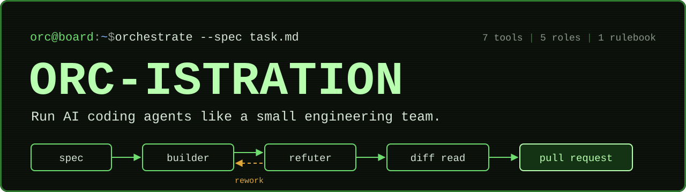
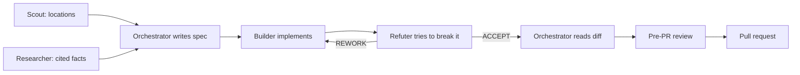

# `Orc-istration`



[](https://github.com/Co0pDawg/Orc-istration/actions/workflows/test.yml?query=branch%3Amain+event%3Apush)

**Run AI coding agents like a small engineering team.**

`Orc-istration` is a method and a toolkit for multi-agent coding work. One orchestrator plans and reviews, cheap agents search, expensive agents build, and an adversarial reviewer tries to break each built change before a person sees it. One tool-neutral rulebook and five agent roles are turned into native files for seven agent tools.

It is not an autonomous swarm. A person stays in charge: a spec is written before any code, each built change gets an independent review, and nothing counts as done until the orchestrator has read the final diff.

> **Status: developed and used on Claude Code; early on other tools.** The full loop has run live only on Claude Code. Antigravity CLI has had one live run of a generated agent, and the other five adapters are verified by tests against each tool's documented format. See [Limits](#limits).

Full documentation lives in the [wiki](https://github.com/Co0pDawg/Orc-istration/wiki).

## How it works

- **A spec comes first.** The orchestrator is the main chat session. Before anything is built it writes a ten-item brief called the marching orders.
- **Cheap agents look, expensive agents build.** A subagent is a separate agent the orchestrator starts with that brief; it works in its own context and returns a short report. Each role runs on a tier (Low, Mid or High), which maps to a cheaper or more capable model per tool. Scouts (Low) find files, researchers (Mid) read docs and report cited facts, and a builder (High) implements exactly the spec and runs the filtered tests.
- **Every built change is attacked.** A refuter (High), which did not write the code, reviews the diff against the spec, reruns the tests, mutation-checks them, and returns ACCEPT or REWORK.
- **Rework is bounded.** REWORK goes back to the same builder. After two rounds the orchestrator reads the diff and decides.
- **The orchestrator signs off.** It reads the final diff itself, picks a pre-PR review tier, and opens a pull request.
- **You can watch it happen.** Agents post their progress to a live board, one card per task.
- **Costs are counted.** Every task writes a cost record, and the rules are tuned on that data.



## What is in the box

**The roster** (`roles/*.md`):

| Role | Tier | What it does |
|---|---|---|
| scout | Low | Find files, symbols and call sites. Returns locations only, never file bodies. |
| researcher | Mid | Read docs, source or the web; every fact cited or marked UNVERIFIED. |
| builder | High | Implement exactly the spec, run the build and filtered tests, mutation-check one new test. |
| refuter | High | Try to prove the diff wrong against the spec; rerun tests; ACCEPT or REWORK. Never edits. |
| debugger | High | Root cause for a failure that is not obvious. Reproduces first. |

**The marching orders.** Every dispatch carries the same ten items, in order:

1. Goal, in one sentence.
2. Scope: exact files or URLs.
3. May change and must not change.
4. Must verify: the commands to run.
5. Do not: the known traps.
6. Output format and cap (40 lines by default).
7. Known: facts already established.
8. Scratch path for anything over the cap.
9. Data precondition: the real rows or paths the feature depends on.
10. Board: the card and stage the agent updates.

**The board.** A live status page with one block per session and one card per task moving through its stages, so the person running the agents can follow the work without reading transcripts. It lives in its own repo, [Orc-Dashboard](https://github.com/Co0pDawg/Orc-Dashboard).


**Repo standards.** `orc standards` sets up a project's coding standards: `STANDARDS.md` at its root, which builders follow and refuters check diffs against, section by section. It detects the project's stacks and composes the file from a cited archive (`standards/`: ASP.NET Core, C#, Go, Java, Playwright, PowerShell, Python, React, Rust, SQL, TypeScript), from the team's own files (`--from`), or both. Before the first build in a repo without one, the orchestrator runs the setup in [`orchestration/standards.md`](orchestration/standards.md): it detects the stacks, then asks you in one several-picks question which to adopt and whether you have your own standards to import, then applies. A re-apply never overwrites a file the team has edited unless forced, and then keeps a backup. Claude Code gets the procedure as the `repo-standards` skill.

**The cost log.** Every orchestrated task writes one record: a row per dispatch with agent, model, tokens, minutes, result and a value label (`earned`, `marginal` or `waste`). The format and the review questions are in [`orchestration/README.md`](orchestration/README.md).

## Evidence

The first cost review ([`orchestration/README.md`](orchestration/README.md), 13 records) covered about 14.5M subagent tokens over about 110 dispatches. Of those the review labelled, 80 were earned, 9 marginal and 4 waste. The High tier took about 75% of the spend. Scouts were half marginal, and all four wastes were rate-limit failures or a dispatch in the wrong folder. The rules changed because of it: a cap of three High-tier agents in flight, scouts limited to locations, a data-precondition item in the marching orders, and a mandatory orchestrator-context line in each record.

Every change that goes through the build loop gets an independent adversarial review before a person sees it; only small inline fixes (a one-line change, anything under about five tool calls) skip it. The refuter reruns the tests itself and mutation-checks them (it breaks the code and confirms a test fails). The incidents behind each rule are recorded in [`docs/rulebook-notes.md`](docs/rulebook-notes.md).

## Works with

| Tool | What gets generated | Verified how | Main gap |
|---|---|---|---|
| Claude Code | `CLAUDE.md` + `agents/*.md` in `~/.claude` | The loop has run on the earlier Claude-only rulebook; the files generated from this repo have not run live yet | Builder and debugger keep MCP tools (no allowlist) |
| Antigravity CLI | `~/.gemini/AGENTS.md` + `config/agents/` | One headless live run of the scout (2026-11-15) | Models only `flash` or `pro`; no per-agent effort |
| Gemini CLI | `~/.gemini/GEMINI.md` + `agents/` | Golden-file tests against documented formats | No nested or documented parallel subagents |
| Codex CLI | `~/.codex/AGENTS.md` + `agents/*.toml` | Golden-file tests against documented formats | No tool allowlist; Windows through WSL2 |
| Cursor | Project `AGENTS.md` + `~/.cursor/agents/` | Golden-file tests against documented formats | No global rulebook; model ids must be set |
| GitHub Copilot CLI | `copilot-instructions.md` + `agents/*.agent.md` | Golden-file tests against documented formats | Model ids must be set; coarse tool aliases |
| OpenCode | `~/.config/opencode/AGENTS.md` + `agents/` | Golden-file tests against documented formats | One documented model id for every tier |

Details per tool: [Supported Tools](https://github.com/Co0pDawg/Orc-istration/wiki/Supported-Tools).

## Quick start

Requires Node 22 or later. No dependencies.

**Claude Code.** This repo is rooted at `~/.claude` (see "Restore on a new machine"). After editing `AGENTS.md`, `roles/` or `adapters/`:

```
node tools/orc.mjs sync      # regenerates CLAUDE.md and agents/*.md
npm test                     # golden files, install tests, and check
```

Then, in each project, set up its coding standards: the `repo-standards` skill ([`orchestration/standards.md`](orchestration/standards.md)).

**Antigravity CLI.** From a clone of this repo:

```
node tools/orc.mjs check
node tools/orc.mjs install --tool antigravity                 # dry run
node tools/orc.mjs install --tool antigravity --apply --board http://localhost:8377/ --board-repo <path to Orc-Dashboard>
agy models | node tools/orc.mjs models --tool antigravity --from-stdin
```

Save the last command's output as `models.local.json`. Then, in each project, run the standards setup in [`orchestration/standards.md`](orchestration/standards.md); `install` prints this pointer too. The rest: [Install and Quick Start](https://github.com/Co0pDawg/Orc-istration/wiki/Install-And-Quick-Start).

## Repository layout

| Path | What it is |
|---|---|
| `AGENTS.md` | The tool-neutral rulebook (the source) |
| `CLAUDE.md`, `agents/*.md` | Generated Claude Code files (`node tools/orc.mjs sync`) |
| `roles/*.md` | The five agent roles: tier, access, capabilities, body |
| `profiles/*.md` | Optional rulebook additions (`--profile <name>`); `dotnet-azure-devops` holds the long rulebook's stack rules and general lessons |
| `models.json` | Tier to model, per tool; `models.local.json` (untracked) overrides |
| `adapters/<tool>.mjs`, `.notes.md` | One adapter per tool: format, install paths, gaps, notes |
| `tools/orc.mjs`, `tools/lib/` | Generator and installer: `build`, `check`, `sync`, `golden`, `install`, `uninstall`, `status`, `models`; method tooling: `brief`, `review-tier`, `costlog`, `dispatch`, `hooks`, `standards`; `help` |
| `tests/` | `npm test`: golden files per tool (`node tools/orc.mjs golden` regenerates them), install and check tests |
| `CONTRIBUTING.md` | How to change this repo: sources vs generated files, the edit loop, traps |
| `docs/cli.md` | The full command reference |
| `orchestration/README.md` | Cost-log format and review questions |
| `standards/`, `orchestration/standards.md`, `skills/repo-standards/` | The coding-standards archive (format in `standards/README.md`), the tool-neutral setup procedure, and its Claude Code skill |
| `docs/` | Rulebook incident notes; outlines for unattended runs and project memory |
| `settings.example.json` | Claude Code hooks, status line and plugins, with no permissions |
| `hooks.node.example.json` | The board-reminder hooks on Node (`hooks --node`) |
| `tools/board-reminder.ps1`, `tools/board-reminder.mjs`, `tools/peon/` | Claude Code hooks: board reminder (PowerShell or Node), sound alert while input is pending |
| `tools/worklog/` | A Windows-only example of time tracking on the hooks (one ticket format, Azure DevOps); not part of the method |
| `.github/workflows/` | CI: tests and `check` on Ubuntu and Windows |

## Limits

- The full loop has run live only on Claude Code, and that was with the earlier Claude-only rulebook: the rulebook and agent files generated from this repo have not run a live session yet. Antigravity CLI has had one headless run of the generated scout.
- Gemini CLI, Codex, Cursor, Copilot and OpenCode are verified by tests against documented formats only.
- Cursor and Copilot need model ids set in `models.local.json`; until then they use `inherit` or the default model.
- Hooks, the worklog and sound alerts are Claude Code extras. On other tools the board update after each report is a build-loop step.
- The artifact board backend can be written only from Claude Code; other tools use the local board.
- The setup assumes Windows with PowerShell 7 and Git Bash; the worklog hooks need porting for macOS or Linux.

## Which Claude do I need?

The full setup runs in Claude Code (terminal, IDE extension, or the desktop app's Code tab), which reads `~/.claude`. The claude.ai chat app can only view a board someone shared. To use the planning discipline there, paste the "Marching orders" and "Build loop" sections of `AGENTS.md` into a Project's instructions.

## Command reference

Every command is `node tools/orc.mjs <command>`. Options: `node tools/orc.mjs help <command>`. Full reference: [docs/cli.md](docs/cli.md).

| Command | Purpose |
|---|---|
| `build` | Write every tool's generated files to `dist/<tool>/` (untracked), with sizes and gaps |
| `check` | Check caps and `models.json`, and that `CLAUDE.md` and `agents/*.md` match the build |
| `sync` | Regenerate the checked-in `CLAUDE.md` and `agents/*.md` |
| `golden` | Regenerate `tests/golden/<tool>/` |
| `install` | Install one tool's files into a home folder (dry run without `--apply`) |
| `uninstall` | Delete the files an install recorded (dry run without `--apply`) |
| `status` | Compare an installed copy with the current build |
| `models` | Turn `agy models` output into a `models.local.json` fragment |
| `brief` | Print or lint a marching-orders brief |
| `review-tier` | Say whether a branch diff is Light-eligible or Full |
| `costlog` | Draft a cost log from the board |
| `dispatch` | Run one role headlessly at its tier |
| `hooks` | Merge the example hooks into `settings.json` (dry run without `--apply`) |
| `standards` | List, show or detect archive coding standards, or compose a project's `STANDARDS.md` (dry run without `--apply`) |
| `help` | List the commands, or one command's options |

CI (`.github/workflows/test.yml`) runs `npm test` and `check` on Ubuntu and Windows, and the worklog self-test on Windows.

## How the .gitignore works

It is an allow-list: `/*` ignores everything in `~/.claude`, then `!` lines re-include named files and folders. Transcripts, credentials, caches, plugins, memory and logs never get staged.

To track a new file:

1. Add `!/path` for it. For a file inside an ignored folder, un-ignore the folder (`!/dir/`), re-ignore its contents (`/dir/*`), then add `!/dir/file` (see the `agents/` block).
2. Check with `git check-ignore <path>` (no output means it can be tracked; `-v` also prints the `!` rule that re-includes it), then `git status`.
3. Never allow-list credentials, `settings.local.json`, `projects/` or `history.jsonl`.

## Restore on a new machine

`~/.claude` usually exists already (Claude Code creates it), so do not `git clone` into it. Back up any existing `CLAUDE.md` first, because `checkout -f` replaces it.

```
cd ~/.claude
git init -b main
git remote add origin https://github.com/Co0pDawg/Orc-istration.git
git fetch origin
git checkout -f main        # overwrites tracked files only; ignored files stay
```

If git reports "dubious ownership", run `git config --global --add safe.directory C:/Users/<user>/.claude` once. Do not copy `settings.example.json` over `settings.json`: run `node tools/orc.mjs hooks --home <your home>` to see the hook entries it would add, then add `--apply` (it backs up `settings.json` and adds only missing hooks, with `<you>` replaced). Use `--node` for the board reminder without PowerShell. The example's other keys (`model`, `statusLine`, `enabledPlugins`, `extraKnownMarketplaces`, `effortLevel`, `env`, `modelSettings`, `autoUpdatesChannel`, `theme`, `agentPushNotifEnabled`) are optional preferences: copy any you want by hand. Clone the board repo into `orchestration/board`, and put the board address in `~/.claude/board.local.md`.

## Not in the repo (reinstall or recreate)

- Plugins and marketplaces named in `settings.example.json` (`enabledPlugins`, `extraKnownMarketplaces`): install them with `/plugin`. The status line points into the ponytail plugin's cache, so it works only after that plugin is installed.
- peon-ping (sound alerts): install it into `hooks/peon-ping/` and keep only the `tools/peon/peon-hook.ps1` entries on PermissionRequest and Notification; delete the entries its installer adds. Turn every category off except `input.required`. Without peon-ping the wrapper does nothing.
- Credentials: log in again (`/login`, and `gh auth login` if used).
- Project memory (`projects/<project>/memory/`): see `docs/project-memory.md`.
- Scheduled tasks and their scripts: see `docs/ops-automation.md`; recreate Task Scheduler entries by hand.
- The worklog's 15-minute sync task: run `pwsh -NoProfile -File ~/.claude/tools/worklog/register-timeline-task.ps1` once, and set `ORC_ADO_SCRIPT` or `WORKLOG_ADO` (`tools/worklog/README.md`).

## Contributing

Agents and people changing this repo: start with [CONTRIBUTING.md](CONTRIBUTING.md).

Push a branch and open a pull request against `main`. Report bugs and ideas in [Issues](https://github.com/Co0pDawg/Orc-istration/issues).

---

<sub>Built with Orc-istration 🧌</sub>
