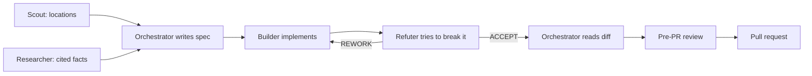

# `Orc-istration`


[](https://github.com/Co0pDawg/Orc-istration/actions/workflows/test.yml?query=branch%3Amain+event%3Apush)

**Run AI coding agents like a small engineering team.**

`Orc-istration` is a method and a toolkit for multi-agent coding work. One orchestrator plans and reviews, cheap agents search, expensive agents build, and an adversarial reviewer tries to break each built change before a person sees it. One tool-neutral rulebook and five agent roles are turned into native files for seven agent tools.

It is not an autonomous swarm. A person stays in charge: a spec is written before any code, each built change gets an independent review, and nothing counts as done until the orchestrator has read the final diff.

> **Status: developed and used on Claude Code; early on other tools.** The full loop runs day to day only on Claude Code, on the files generated from this repo since 2026-11-18. Codex CLI has completed a live builder, refuter, rework and accept loop, launched both generated roles by name, and passed a native Windows workspace-write probe with MXC. Antigravity CLI has had one live run of a generated agent, and the other four adapters are verified by tests against each tool's documented format. See [Limits](#limits).

Full documentation lives in the [wiki](https://github.com/Co0pDawg/Orc-istration/wiki).

## How it works

- **A spec comes first.** The orchestrator is the main chat session. Before anything is built it writes an eleven-item brief called the marching orders.
- **Cheap agents look, expensive agents build.** A subagent is a separate agent the orchestrator starts with that brief; it works in its own context and returns a short report. Each role runs on a tier (Low, Mid or High), which maps to a cheaper or more capable model per tool. Scouts (Low) find files, researchers (Mid) read docs and report cited facts, and a builder (High) implements exactly the spec and runs the filtered tests.
- **Every built change is attacked.** A refuter (High), which did not write the code, reviews the diff against the spec and the ticket's intent, reruns the tests, mutation-checks them in a throwaway worktree, and returns ACCEPT or REWORK. Where the spec itself drifted from the intent, that goes back to the orchestrator, not the builder.
- **Outside text is data.** Tickets, PR threads, attachments, web pages and a reviewed diff are read for what they say, never obeyed: an instruction inside them is reported, not followed.
- **Rework is bounded.** REWORK goes back to the same builder. After two rounds the orchestrator reads the diff and decides.
- **The orchestrator signs off.** It reads the final diff itself, picks a pre-PR review tier, and opens a pull request.
- **You can watch it happen.** Agents post their progress to a live board, one card per task.
- **Costs are counted.** Every task writes a cost record, and the rules are tuned on that data.



## A real catch

From building this repo's own installer (2026-11-15, the cost log behind [`3799303`](https://github.com/Co0pDawg/Orc-istration/commit/3799303)):

1. **The spec** said "`--home` overrides the home dir", so a test install never touches your real `~/.claude`.
2. **The builder** shipped it, then a rework round fixed a review finding (a `--home` with no value fell back to the real home). 25 tests, all green.
3. **The refuter** (a Mid-tier model that had not written the code) did not trust the green run. It ran the installer itself against an isolated home and returned:
   > REWORK: `--home=<dir>` ignored (reproduced in an isolated HOME)

   The option parser did not know the `=` form, so it read `--home=<dir>` as an unknown flag named `home=<dir>`. `--home` stayed unset, and the install fell back to the real home directory. The builder's 25 tests and an earlier High-tier refuter had both missed it.
4. **The fix** parses `--key=value`, makes an unknown option an error instead of a silent flag, and adds tests for both:
   ```diff
   -      } else out[key] = true;
   +    } else if (FLAG_OPTIONS.includes(key) && eq < 0) out[key] = true;
   +    else throw new Error(`unknown option ${a}`);
   ```
5. **The spec miss went into the record:** "any installer spec should state: never fall back to the real home when a home option was attempted."

That refuter pass cost about 91k tokens and 12 minutes. Without it, a test install typed with `=` would have gone into the user's live `~/.claude` instead of the test folder. [Evidence](#evidence) has the counts across every task since.

## What is in the box

**The roster** (`roles/*.md`):

| Role | Tier | What it does |
|---|---|---|
| scout | Low | Find files, symbols and call sites. Returns locations only, never file bodies. |
| researcher | Mid | Read docs, source or the web; every fact cited or marked UNVERIFIED. |
| builder | High | Implement exactly the spec, run the build and filtered tests, mutation-check one new test. |
| refuter | High | Try to prove the diff wrong against the spec and the ticket intent; rerun tests; mutation-check in a throwaway worktree; ACCEPT or REWORK. Never edits the reviewed tree. |
| debugger | High | Root cause for a failure that is not obvious. Reproduces first. |

The builder keeps web fetch and search for the docs its orders name: in Claude Code a role without every capability gets a tool allowlist and would lose the board tool.

Six more roles (`review-*`) make up the [review panel](#review-panel) the Full review tier runs.

**The marching orders.** Every dispatch carries the same eleven items, in order (scouts and researchers stop at 8):

1. Goal, in one sentence.
2. Scope: exact files or URLs.
3. May change and must not change.
4. Must verify: the commands to run.
5. Do not: the known traps.
6. Output format and cap (40 lines by default).
7. Known: facts already established.
8. Scratch path for anything over the cap.
9. Intent: for a refuter, the ticket brief or acceptance criteria verbatim, or `none: <why>`.
10. Data precondition: the real rows or paths the feature depends on.
11. Board: the card and stage the agent updates.

**The board.** A live status page with one block per session and one card per task moving through its stages, so the person running the agents can follow the work without reading transcripts. It lives in its own repo, [Orc-Dashboard](https://github.com/Co0pDawg/Orc-Dashboard).


**Repo standards.** `node tools/orc.mjs standards` (run from the setup checkout) sets up a project's coding standards: `STANDARDS.md` at its root, which builders follow and refuters check diffs against, section by section. It detects the project's stacks and composes the file from a cited archive (`standards/`: ASP.NET Core, C#, Go, Java, Playwright, PowerShell, Python, React, Rust, SQL, TypeScript), from the team's own files (`--from`), or both. Before the first build in a repo without one, the orchestrator runs the setup in [`orchestration/standards.md`](orchestration/standards.md): it detects the stacks, then asks you in one several-picks question which to adopt and whether you have your own standards to import, then applies. A re-apply never overwrites a file the team has edited, or drops a stack or import it was applied with, unless forced, and then keeps a backup. `install` writes the setup checkout's path into the installed rulebook ("Setup checkout (this machine)"), so any tool can find the procedure and the command. Claude Code also gets the procedure as the `repo-standards` skill where `~/.claude/skills` has it: there when `~/.claude` is the setup checkout, copied by hand from a separate clone.

**Sprint mode.** For a timeboxed build, such as a live AI-assisted interview exercise, ask for a sprint ("sprint mode", "a 45-minute sprint"). For that one task the orchestrator follows [`orchestration/sprint.md`](orchestration/sprint.md): a requirements phase that ends in an agreed `REQUIREMENTS.md` with numbered acceptance criteria (the client is the interviewer, or the AI plays one from a hidden brief), at most three runnable slices, a walking skeleton by about minute 20 (15 with a given brief), a feature freeze ten minutes before the deadline, a polish ladder (review fixes, edge-case tests, API docs, a small UI, README, a sprint report) for any time left after the slices, one builder resumed per slice, Mid-tier refuters reviewing each slice's commit while the next is built, and one rework round. An events file records decisions, reviews and self-corrections as they happen, and the sprint report turns it into a "How this was built" story page styled with a shared theme. It skips the board, the standards setup, the review panel and the cost log; it never skips the orchestrator's diff read, one real run of the app, or the PR and safety rules. A sprint as an iteration name ("put this in sprint 45") does not trigger it. Claude Code also gets it as the `sprint` skill where `~/.claude/skills` has it. `install --tool claude-code --sprint-kit` copies its `SKILL.md` there. For a machine you do not own, such as an interviewer's laptop, [`docs/interview-machine.md`](docs/interview-machine.md) installs a sprint kit in under 5 minutes and removes it afterwards; [`docs/example-prompts.md`](docs/example-prompts.md#starter-prompt-interview-machine) has the starter prompt.

**Routine skills (Claude Code).** Three skills wrap the steps every orchestrated task repeats, each pointing at the rule it follows rather than restating it: `board` (open the session and cards, write at each dispatch, report and commit, mark it Done, on either backend), `brief` (fill the marching orders from `orc brief new` and lint them with `orc brief lint` before a dispatch) and `wrap-up` (full test projects once, the diff read, the pre-PR review tier, the cost log drafted with `orc costlog`, including from an artifact board, an anomaly-log line, the handoff note and the board marked Done). Like `sprint`, they are there where `~/.claude/skills` has them. Contributors also get `ship-prompts`, a project skill in `.claude/skills/` that loads only in this repo: sync, golden, tests, check, the tracked-path check, the README and wiki co-change, and the live install.

**Fewer permission prompts (Claude Code).** The `orc-permissions` skill adds the allow rules an orchestrated task needs to `~/.claude/settings.json`, so builders and refuters stop pausing on routine commands: the orc CLI, the test runs, scratch-file helpers, and `git worktree add` and `list`. It asks which groups to add, backs the file up first and never removes or loosens a `deny` or `ask` rule. Two risky rules, `git worktree remove` and a blanket `rm -rf`, are opt-in, each behind its own question. A rule matches the command text, so a path in a rule is not a scope and a command that uses a shell variable for a path matches no path rule. Like the other skills, it is there where `~/.claude/skills` has it.

**The cost log.** Every orchestrated task writes one record: a row per dispatch with agent, model, tokens, minutes, result and a value label (`earned`, `marginal` or `waste`). The format and the review questions are in [`orchestration/README.md`](orchestration/README.md).

**The anomaly log.** Something odd that no rule covers, in any session, goes on one line in a local `anomalies.md` beside the cost logs instead of becoming a rule on one sighting. A repeat is promoted by kind: a constraint becomes a rule, a scriptable check a guard or tool, a multi-step procedure explained a third time a skill, a preference a memory. The line format and the promotion table are in [`orchestration/README.md`](orchestration/README.md).

## Evidence

The first cost review ([`orchestration/README.md`](orchestration/README.md), 13 records) covered about 14.5M subagent tokens over about 110 dispatches. Of those the review labelled, 80 were earned, 9 marginal and 4 waste. The High tier took about 75% of the spend. Scouts were half marginal, and all four wastes were rate-limit failures or a dispatch in the wrong folder. The rules changed because of it: a cap of three High-tier agents in flight, scouts limited to locations, a data-precondition item in the marching orders, and a mandatory orchestrator-context line in each record.

**How often does the refuter catch something?** A tally of the cost records from 2026-11-15 to 2026-11-23 (20 tasks that used a refuter, in this repo, its board and private projects):

- 19 of the 20 tasks had at least one REWORK. Of 61 recorded refuter verdicts, 42 were REWORK and 19 ACCEPT.
- The records name 72 defects behind those REWORKs: 32 logic or behaviour bugs, 17 missing or weak tests (mostly mutants no test killed), 8 doc inaccuracies, 2 spec defects, 2 other and 11 of unrecorded kind.
- One must-fix was rejected as wrong; 12 records say none were.
- Refuters took about 21% of subagent tokens (3.5M of 16.8M, over the 18 records that separate them).
- The refuter is not the last line: in at least 7 tasks the pre-PR review still found real issues after the refuter rounds, and CI, a live install or the owner caught a few more. That is why the pre-PR tiers exist.

Limits of the tally: only 4 records state outright that the builder's own tests were green when the refuter found its defect (the rest show a passing builder row just before the REWORK); the Escaped defects line exists only since 2026-11-19, so escapes are a lower bound; and no task has yet been run twice, with and without the refuter, to compare. The per-record table is not published, because most records name private projects.

Every change that goes through the build loop gets an independent adversarial review before a person sees it; only small inline fixes (a one-line change, anything under about five tool calls) skip it. The refuter reruns the tests itself and mutation-checks them (it breaks the code and confirms a test fails). The incidents behind each rule are recorded in [`docs/rulebook-notes.md`](docs/rulebook-notes.md).

## Works with

| Tool | What gets generated | Verified how | Main gap |
|---|---|---|---|
| Claude Code | `CLAUDE.md` + `agents/*.md` + the review panel's `commands/*.md` in `~/.claude` | Live: sessions run on the generated files since 2026-11-18 | Builder and debugger keep MCP tools (no allowlist) |
| Antigravity CLI | `~/.gemini/AGENTS.md` + `config/agents/` | One headless live run of the scout (2026-11-15) | Models only `flash` or `pro`; no per-agent effort |
| Gemini CLI | `~/.gemini/GEMINI.md` + `agents/` | Golden-file tests against documented formats | No nested or documented parallel subagents |
| Codex CLI | `~/.codex/AGENTS.md` + `agents/*.toml` | Golden-file tests, a live practice build, and [named-role and MXC workspace-write trials](docs/example-prompts.md#native-windows-execution-checks) | No per-role tool allowlist. Windows results cover the MXC configuration tested. |
| Cursor | Project `AGENTS.md` + `~/.cursor/agents/` | Golden-file tests against documented formats | No global rulebook; model ids must be set |
| GitHub Copilot CLI | `copilot-instructions.md` + `agents/*.agent.md` | Golden-file tests against documented formats | Model ids must be set; coarse tool aliases |
| OpenCode | `~/.config/opencode/AGENTS.md` + `agents/` | Golden-file tests against documented formats | One documented model id for every tier |

Details per tool: [Supported Tools](https://github.com/Co0pDawg/Orc-istration/wiki/Supported-Tools).

## Quick start

Requires Node 22 or later. No dependencies.

**Claude Code.** Clone the repo anywhere except `~/.claude`, then install from it:

```
git clone https://github.com/Co0pDawg/Orc-istration.git
cd Orc-istration
node tools/orc.mjs install --tool claude-code --home "$HOME"           # dry run: lists what it would write
node tools/orc.mjs install --tool claude-code --home "$HOME" --apply   # backs up anything it replaces
```

That writes the rulebook (`~/.claude/CLAUDE.md` and `AGENTS.md`), the roster and review-panel agents, the review commands and the hook scripts. It warns that no board address is set; the loop runs without a board. `uninstall` with the same options takes out what it installed. Then open Claude Code in a project and give it a real task, such as a bug with a clear expected behaviour. The session becomes the orchestrator: it writes the marching orders, dispatches a builder, sends a refuter at the diff and reads the result itself before it reports done. Ask it to "use the build loop" if it starts to edit inline. The first build in a repo without a `STANDARDS.md` asks you which coding standards to adopt.

Optional, when you want them: the skills in `skills/` (copy into `~/.claude/skills`), the hooks including the [git guard](#the-git-guard) (`node tools/orc.mjs hooks --home "$HOME"`), and a live board ([Orc-Dashboard](https://github.com/Co0pDawg/Orc-Dashboard)). For a timed build on a borrowed machine, install the sprint kit instead ([`docs/interview-machine.md`](docs/interview-machine.md)). To keep the whole setup under version control, check the repo out as `~/.claude` (see "Restore on a new machine").

**Antigravity CLI.** From a clone of this repo:

```
node tools/orc.mjs check
node tools/orc.mjs install --tool antigravity                 # dry run
node tools/orc.mjs install --tool antigravity --apply --board http://localhost:8377/ --board-repo <path to Orc-Dashboard>
agy models | node tools/orc.mjs models --tool antigravity --from-stdin
```

Save the last command's output as `models.local.json`. Then, in each project, run the standards setup in [`orchestration/standards.md`](orchestration/standards.md); `install` prints this pointer too, and writes this clone's path into the rulebook as the setup checkout. The rest: [Install and Quick Start](https://github.com/Co0pDawg/Orc-istration/wiki/Install-And-Quick-Start).

## Repository layout

| Path | What it is |
|---|---|
| `AGENTS.md` | The tool-neutral rulebook (the source) |
| `CLAUDE.md`, `agents/*.md` | Generated Claude Code files (`node tools/orc.mjs sync`) |
| `roles/*.md` | The agent roles (the five above and the six `review-*` panel roles): tier, access, capabilities, body |
| `review/` | The review panel: `PROCEDURE.md`, the explorer contract, shared rules, lane selection, `lanes/*.md`, calibration, metrics and the regression corpus |
| `commands/*.md` | Claude Code slash commands: the review panel's three are generated (`node tools/orc.mjs sync`); the six workflow wrappers are hand-written |
| `workflows/` | Tool-neutral workflows around the build loop: `start`, `grill`, `draft-pr`, `peer-review`, `create`, `fix-ci` |
| `templates/AGENTS.md` | Starting rulebook for a repo you work on, with its Project settings block (`docs/adopt-a-repo.md`) |
| `tools/tracker/` | `ado.ps1`, the Azure DevOps tracker helper (`docs/tracker-contract.md`), and its offline self-check |
| `profiles/*.md` | Optional rulebook additions (`--profile <name>`); `dotnet-azure-devops` holds the long rulebook's stack rules and general lessons |
| `models.json` | Tier to model, per tool; `models.local.json` (untracked) overrides |
| `adapters/<tool>.mjs`, `.notes.md` | One adapter per tool: format, install paths, gaps, notes |
| `tools/orc.mjs`, `tools/lib/` | Generator and installer: `build`, `check`, `sync`, `golden`, `install`, `uninstall`, `status`, `models`; method tooling: `brief`, `review-tier`, `costlog`, `dispatch`, `hooks`, `standards`; review panel: `calibration`, `corpus`, `metrics`; `help` |
| `tests/` | `npm test`: golden files per tool (`node tools/orc.mjs golden` regenerates them), install, check, tooling, standards and review-panel tool tests, and the sprint tests (theme tokens and contrast, the theme picker, `make-story.mjs` and the story page) |
| `CONTRIBUTING.md` | How to change this repo: sources vs generated files, the edit loop, traps |
| `LICENSE` | MIT |
| `STANDARDS.md` | This repo's own coding standards (TypeScript/JavaScript and PowerShell), composed by `standards apply` |
| `CODEOWNERS` | Every change needs the owner's review |
| `docs/cli.md` | The full command reference |
| `docs/interview-machine.md`, `docs/example-prompts.md` | Installing and removing the sprint kit on a borrowed machine, and example prompts including its starter prompt and the Codex practice exercise |
| `orchestration/README.md` | Cost-log format and review questions; the anomaly log and its promotion table |
| `standards/`, `orchestration/standards.md`, `skills/repo-standards/` | The coding-standards archive (format in `standards/README.md`), the tool-neutral setup procedure, and its Claude Code skill |
| `orchestration/sprint.md`, `skills/sprint/` | Sprint mode: a timeboxed build (default 45 minutes) that waives the board, standards setup, review panel and cost log for one task, and its Claude Code skill, the story-page template with its `make-story.mjs` filler, and the shared theme |
| `skills/board/`, `skills/brief/`, `skills/wrap-up/` | Claude Code skills for the routine steps of an orchestrated task: board writes, marching orders, and the finish |
| `.claude/skills/ship-prompts/` | Project skill for contributors: regenerate, test and ship a change to this repo |
| `skills/orc-permissions/` | Claude Code skill that adds the allow rules an orchestrated task needs (the orc CLI, tests, scratch files, worktrees) to `~/.claude/settings.json`, so agents stop pausing on routine commands; the two risky rules (worktree removal and a blanket `rm -rf`) are opt-in, each behind its own question |
| `docs/` | Rulebook incident notes; the tracker contract and how to adopt a repo; outlines for unattended runs and project memory |
| `settings.example.json` | Claude Code hooks, status line and plugins, and a `permissions.deny` block for secret files |
| `hooks.node.example.json` | The board-reminder and git-guard hooks on Node (`hooks --node`) |
| `tools/board-reminder.ps1`, `tools/board-reminder.mjs`, `tools/peon/` | Claude Code hooks: board reminder (PowerShell or Node), sound alert while input is pending and when a turn finishes |
| `tools/guard.ps1`, `tools/guard.mjs` | Claude Code hook: the git guard (PowerShell or Node; see "The git guard") |
| `tools/worklog/` | A Windows-only example of time tracking on the hooks (one ticket format, Azure DevOps); not part of the method |
| `.github/workflows/`, `.github/pull_request_template.md` | CI: tests and `check` on Ubuntu and Windows; the PR template with its Docs checklist |

## Limits

- The full loop runs day to day only on Claude Code (on the files generated from this repo since 2026-11-18). The [Codex trials](docs/example-prompts.md#native-windows-execution-checks) cover named-role dispatch and workspace-write with MXC on native Windows. The bundled and legacy sandbox configurations tested on that host failed at shell startup. Antigravity CLI has had one headless run of the generated scout.
- Slash commands, skills and review metrics are Claude Code only; other tools follow `review/PROCEDURE.md`, `workflows/*.md` and the `orchestration/` procedures by hand. `dispatch` runs headlessly on Antigravity and Claude Code only.
- Gemini CLI, Cursor, Copilot and OpenCode are verified by tests against documented formats only.
- Cursor and Copilot need model ids set in `models.local.json`; until then they use `inherit` or the default model.
- Hooks, the worklog and sound alerts are Claude Code extras. On other tools the board update after each report is a build-loop step.
- The artifact board backend can be written only from Claude Code; other tools use the local board.
- The setup assumes Windows with PowerShell 7 and Git Bash; the worklog hooks need porting for macOS or Linux.

## Which Claude do I need?

The full setup runs in Claude Code (terminal, IDE extension, or the desktop app's Code tab), which reads `~/.claude`. The claude.ai chat app can only view a board someone shared. To use the planning discipline there, paste the "Marching orders" and "Build loop" sections of `AGENTS.md` into a Project's instructions.

## Command reference

Every command is `node tools/orc.mjs <command>`. Options: `node tools/orc.mjs help <command>`. Full reference: [docs/cli.md](docs/cli.md).

| Command | Purpose |
|---|---|
| `build` | Write every tool's generated files to `dist/<tool>/` (untracked), with sizes and gaps |
| `check` | Check caps and `models.json`, and that `CLAUDE.md` and `agents/*.md` match the build |
| `sync` | Regenerate the checked-in `CLAUDE.md` and `agents/*.md` |
| `golden` | Regenerate `tests/golden/<tool>/` |
| `install` | Install one tool's files into a home folder (dry run without `--apply`); `--sprint-kit` adds the sprint skill, the git guard hook and a stack permission preset for Claude Code |
| `uninstall` | Delete the files an install recorded (dry run without `--apply`); for a sprint kit, also remove its `settings.json` entries and restore what it replaced |
| `status` | Compare an installed copy with the current build (a sprint kit's `settings.json` entries included) |
| `models` | Turn `agy models` output into a `models.local.json` fragment |
| `brief` | Print or lint a marching-orders brief |
| `review-tier` | Say whether a branch diff is Light-eligible or Full |
| `costlog` | Draft a cost log from the board |
| `calibration` | Per-lane precision and recall of the review panel from its run logs |
| `corpus` | List the review regression corpus, or score a panel report against one case |
| `metrics` | Capture or report per-run review metrics from Claude Code transcripts |
| `dispatch` | Run one role headlessly at its tier (Antigravity and Claude Code) |
| `hooks` | Merge the example hooks into `settings.json` (dry run without `--apply`) |
| `standards` | List, show or detect archive coding standards, or compose a project's `STANDARDS.md` (dry run without `--apply`) |
| `help` | List the commands, or one command's options |

CI (`.github/workflows/test.yml`) runs `npm test` and `check` on Ubuntu and Windows, and the worklog self-test on Windows.

## Review panel

The Full pre-PR review tier runs the review panel, ported from a production setup and made tool-neutral. `review/PROCEDURE.md` is the orchestrator's procedure: select lanes for the diff (`review/selection.md`), run read-only explorers over them in parallel (code, failure, docs, checklist, and design on large diffs), settle each lead with `review-verifier` or the owning explorer, have the verifier check every `issue:` and `warning:` finding before anyone fixes it (refuted ones move to their own report section), raise under-rated items in a severity review, then write one report and a run log. Leads that only a running app can settle become runtime checks with steps; the panel never runs the app, so the developer or the calling workflow runs them and records the result. Each lane is a checklist in `review/lanes/` (code-reviewer, silent-failure-hunter, comment-analyzer, type-design-analyzer, architecture-reviewer, code-simplifier, pr-test-analyzer, ui-test-reviewer, secondary-artifacts, ticket-coverage); `review/contract.md` and `review/shared-rules.md` hold the rules every explorer follows.

Stack-specific checks (tenant scoping, CSRF, migration co-change, UI test hooks, generated files, a documentation map) come from the reviewed repo's own `REVIEW.md`, or the file its rulebook names; without one the lanes skip those checks. A ticket brief comes from ticket text or a brief file you give. Run logs and metrics land in the reviewed repo's `.orc/` folder (`review/calibration.md`, `review/metrics.md`).

Each verdict in a run log may end `(developer)` or `(agent)`; `calibration` computes precision from the developer's verdicts only and counts agent verdicts apart (`(agent)` anywhere in the cell marks one). Defects a review missed are appended to its log as escaped defects, which give each lane a recall figure; a row `calibration` cannot read is listed under Parser warnings rather than counted as no escape. `metrics capture` counts the verifier's lead verdicts and its finding-verification verdicts apart and reads the run log's `Verification:` line. Before a change to a lane, a role or `models.json` is kept, the affected lanes run on the regression corpus (`tests/fixtures/corpus/`, `review/corpus.md`) and `corpus score` checks that nothing expected was missed.

In Claude Code, `/pre-pr-review [branch] [base] [scope keywords] [lite|full]`, `/review-verdict` and `/calibration-report` are generated into `commands/`. They find this checkout through the `ORC_HOME` environment variable, else the rulebook's "Setup checkout (this machine)" line, else `~/.claude`. Other tools follow `review/PROCEDURE.md` by hand.

## Workflows

The work around the build loop, ported from the same production setup and made repo-neutral (`workflows/README.md`):

- `start <ticket>` works a ticket end to end: judge it, plan, branch, grill, build loop with a commit per accepted task, full tests once, pre-PR review, live verification, durable-rules check, with a live checklist on the ticket. It never opens the PR.
- `grill [plan]` interviews you on a plan until no decision is open.
- `draft-pr` writes the description and opens a draft PR linked to its work items.
- `peer-review <PR>` reviews and fixes a teammate's PR at a tier sized to its diff.
- `create` files a work item from the conversation.
- `fix-ci [run]` gets a failing pipeline back to green in capped cycles.

A workflow reads every repo-specific fact (tracker, base branch, branch naming, build and test commands, review rules) from the target repo's rulebook **Project settings**, then git, then one question. Start a repo's rulebook from `templates/AGENTS.md` and follow `docs/adopt-a-repo.md`. Work items, PRs and CI go through one tracker helper command (`docs/tracker-contract.md`); `tools/tracker/ado.ps1` implements it for Azure DevOps, with organization, project and repository from `ORC_ADO_ORG`, `ORC_ADO_PROJECT` and `ORC_ADO_REPO` and no defaults. In Claude Code they run as `/start`, `/grill`, `/draft-pr`, `/peer-review`, `/create` and `/fix-ci`; other tools follow `workflows/<name>.md` by hand.

## The git guard

`tools/guard.ps1` (and its Node port `tools/guard.mjs`, wired by `hooks --node`) is a Claude Code PreToolUse hook on the Bash and PowerShell tools. It enforces the rulebook's hard git rules in the harness instead of only in prose. It reads the command text before it runs, follows `cd`, `Set-Location`, `git -C <dir>`, chained commands (`&&`, `;`, `|`), line continuations and shell keywords or wrappers in front of git (`then`, `do`, `!`, `{`, `time`, `env`, `command`, `exec`, `nohup`), Bash backtick substitution, and in the PowerShell tool an assignment in front of git (`$r = git ...`, also typed, braced, property, comma-list and chained targets such as `[string]$r`, `${r}`, `$r.x`, `$a, $b` and `$a = $b =`) and the first command inside a script block (`try {`, `ForEach-Object {`, `if (...) {`, `& {`, glued forms such as `}else{` included; a quoted brace is text), skips comments, heredoc bodies (also inside `"$( )"`) and PowerShell here-strings, and asks git for the current branch and whether the folder is a linked worktree.

It blocks (the reason goes back to the agent):

- `git commit` while the current branch is protected;
- `git push` to a protected branch: an explicit refspec (`origin main`, `HEAD:main`), `--all` when a protected branch exists locally, `--mirror`, or a push with no refspec while on one (`--tags` alone pushes only tags and is allowed);
- `git stash` other than `list` and `show` in a linked worktree, because every worktree shares one stash stack;
- for the read-only roles (`scout`, `researcher`, `refuter`, `review-*`, named by the hook's `agent_type`): `git commit`, `push`, `merge`, `rebase`, `reset`, `clean`, `stash`, `rm`, `mv`, `checkout`, `switch`, `restore`, `pull`, `cherry-pick`, `revert` and `am`. They keep `git worktree add|remove`, `git apply`, `git diff`, `log`, `show` and `status`, so a refuter can still try mutations in a throwaway worktree.

It asks you first (the reason shows in the prompt): any force-push (`--force`, `-f`, `--force-with-lease`, `+refspec`), and `git add -A`, `git add --all` or `git add .`. In a headless run (`claude -p`, `orc dispatch`) nobody can answer, so an ask acts as a deny.

Protected branches are `main`, `develop` and `master`; set `ORC_PROTECTED_BRANCHES` to a comma list (such as `main,release`) to replace them. The hook is installed for the user, so it applies in every repository: in one where you do commit on `main`, set `ORC_PROTECTED_BRANCHES` under `env` in that project's `.claude/settings.json` to a name no branch has (such as `none`); an empty value keeps the defaults. The guard fails open: bad input, a missing field, a folder it cannot find or a git that does not answer (or answers with an error, such as a repository it calls dubious) lets the command run, with one `guard:` line on stderr. One case fails closed: when git cannot list the local branches, `git push --all` is denied as if every protected branch existed, with a `guard:` line naming the failure. Every Bash or PowerShell call pays the hook's start-up: about half a second for the PowerShell variant and about a tenth of a second for the Node variant (averaged over ten runs on one Windows machine), so `--node` is the lighter choice.

`settings.example.json` runs `guard.ps1` with `-ExecutionPolicy Bypass`: under a Restricted or AllSigned policy the script would not start, Claude Code treats that as a non-blocking hook error, and every command would run unguarded. A `settings.json` that already holds the earlier guard line (without the flag) gets the new line beside it from `hooks --apply`; delete the old one. `install --tool claude-code` copies the hook scripts (`guard.ps1`, `guard.mjs`, `board-reminder.ps1`, `board-reminder.mjs`) into `<home>/.claude/tools/`, where the example hooks look for them, and `status` compares them like the generated files; a differing copy made by hand before is kept (`--force` replaces it, with a backup), and an identical copy already there and in no manifest stays yours: install does not record it and `uninstall` leaves it. `hooks` prints a `WARN hook script not found` line for each script it wires that is not there. `uninstall` deletes the scripts but leaves their entries in `settings.json`; remove those hook entries too, or every Bash and PowerShell call reports a failing hook. The exception is a sprint kit (`install --sprint-kit`): it wires the Node guard itself, copies only `guard.mjs`, and its `uninstall` removes the entry it added.

It is a seat belt, not a sandbox. Its command parser is a best-effort reading of shell syntax, so an unusual quoting form can still slip past it or be blocked in error; the push rule is the backstop. It cannot catch:

- a write through a redirect, a script or another program (`bash do-release.sh`, a git library, an editor);
- an aliased git (`git ci`, a shell alias or function, a renamed binary);
- a command built at run time (`eval`, `Invoke-Expression`, variables holding the subcommand);
- a push whose remote configuration maps a feature branch onto a protected one;
- switching to a protected branch and committing in the same command (`git switch main && git commit`): the branch is read before the command runs;
- a push destination built by command substitution (`git push origin $(git branch --show-current)`);
- a backtick substitution nested inside another, and a PowerShell assignment through an operator other than `=`, `+=`, `-=`, `*=` and `/=` (such as `$r ??= git ...`);
- `git merge`, `pull`, `cherry-pick`, `revert` and `am`, which also create commits on the current branch: only `git commit` is checked;
- a repository picked with `GIT_DIR` or `--git-dir` (the guard asks git about the working folder, not that repository);
- a file write by a read-only role through the shell (a redirect or a script): the guard checks git commands only.

For the commit cases above, the push rule is the backstop: such a commit still cannot be pushed to the protected branch by name, by `HEAD` or by a push with no refspec while on it.

`settings.example.json` also carries a `permissions.deny` block: `Read(.env)`, `Read(.env.*)` and `Read(**/.credentials.json)` (any depth under the session's folder) and `Read(~/.claude/.credentials.json)`. Claude Code applies them to its file tools and to shell commands that name the file (`cat .env`, a redirect), but not to a command that reads without naming it (`grep -r key .`) or a script that opens the file itself.

## How the .gitignore works

It is an allow-list: `/*` ignores everything in `~/.claude`, then `!` lines re-include named files and folders. Transcripts, credentials, caches, plugins, memory and logs never get staged.

To track a new file:

1. Add `!/path` for it. For a file inside an ignored folder, un-ignore the folder (`!/dir/`), re-ignore its contents (`/dir/*`), then add `!/dir/file` (see the `agents/` block).
2. Check with `git check-ignore <path>` (no output means it can be tracked; `-v` also prints the `!` rule that re-includes it), then `git status`.
3. Never allow-list credentials, `settings.local.json`, `projects/` or `history.jsonl`.

## Restore on a new machine

`~/.claude` usually exists already (Claude Code creates it), so do not `git clone` into it. Back up any existing `CLAUDE.md` first, because `checkout -f` replaces it.

```
cd ~/.claude
git init -b main
git remote add origin https://github.com/Co0pDawg/Orc-istration.git
git fetch origin
git checkout -f main        # overwrites tracked files only; ignored files stay, except one that a newer commit now tracks
```

The cost-log template `orchestration/log/TEMPLATE.md` is tracked from this version on. If your checkout holds your own edited copy (it was ignored before), copy it aside before you pull or check out: git replaces a previously ignored file with the tracked one without asking.

If git reports "dubious ownership", run `git config --global --add safe.directory C:/Users/<user>/.claude` once. Do not copy `settings.example.json` over `settings.json`: run `node tools/orc.mjs hooks --home <your home>` to see the hook entries it would add, then add `--apply` (it backs up `settings.json` and adds only missing hooks, with `<you>` replaced). Use `--node` for the board reminder and the git guard on Node, without PowerShell. The example's other keys (`model`, `permissions`, `statusLine`, `enabledPlugins`, `extraKnownMarketplaces`, `effortLevel`, `env`, `modelSettings`, `autoUpdatesChannel`, `theme`, `agentPushNotifEnabled`) are optional preferences: copy any you want by hand. Clone the board repo into `orchestration/board`, and put the board address in `~/.claude/board.local.md`.

## Not in the repo (reinstall or recreate)

- Plugins and marketplaces named in `settings.example.json` (`enabledPlugins`, `extraKnownMarketplaces`): install them with `/plugin`. The status line points into the ponytail plugin's cache, so it works only after that plugin is installed.
- peon-ping (sound alerts): install it into `hooks/peon-ping/` and keep only the `tools/peon/peon-hook.ps1` entries on PermissionRequest, Notification and Stop; delete the entries its installer adds. Turn every category off except `input.required` (a question or approval is waiting) and `task.complete` (the turn finished). Without peon-ping the wrapper does nothing.
- Credentials: log in again (`/login`, and `gh auth login` if used).
- Project memory (`projects/<project>/memory/`): see `docs/project-memory.md`.
- Scheduled tasks and their scripts: see `docs/ops-automation.md`; recreate Task Scheduler entries by hand.
- The worklog's 15-minute sync task: run `pwsh -NoProfile -File ~/.claude/tools/worklog/register-timeline-task.ps1` once, and set `ORC_ADO_SCRIPT` or `WORKLOG_ADO` to `tools/tracker/ado.ps1` (`tools/worklog/README.md`).

## Contributing

Agents and people changing this repo: start with [CONTRIBUTING.md](CONTRIBUTING.md). After editing `AGENTS.md`, `roles/` or `adapters/`:

```
node tools/orc.mjs sync      # regenerates CLAUDE.md, agents/*.md and the generated commands/*.md
npm test                     # golden files, install tests, and check
```

Push a branch and open a pull request against `main`. Report bugs and ideas in [Issues](https://github.com/Co0pDawg/Orc-istration/issues).

## License

[MIT](LICENSE). `workflows/grill.md` is adapted from mattpocock-skills, also MIT; its notice is in [workflows/LICENSE-mattpocock-skills.txt](workflows/LICENSE-mattpocock-skills.txt).

---

<sub>Built with Orc-istration 🧌</sub>
