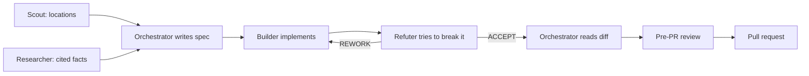

# Orc-istration

Orc-istration is a method and a toolkit for running a team of AI coding agents the way a lead runs a small engineering team: one orchestrator plans and reviews, cheap agents search, expensive agents build, and an adversarial reviewer tries to break each built change before a person sees it. One tool-neutral rulebook and five agent roles are turned into native files for seven agent tools.

The orchestrator is the main chat session. A subagent is a separate agent the orchestrator starts with a written brief; it works in its own context and returns a short report. Each subagent role runs on a tier (Low, Mid or High), which maps to a cheaper or more capable model per tool.

Full documentation lives in the [wiki](https://github.com/Co0pDawg/Orc-istration/wiki).

## How it works

1. The orchestrator writes a spec: a ten-item brief called the marching orders.
2. Scouts (Low tier) find files; researchers (Mid tier) read docs and report cited facts.
3. A builder (High tier) implements exactly the spec and runs the filtered tests.
4. A refuter (High tier) reviews the diff against the spec, reruns the tests, mutation-checks them, and returns ACCEPT or REWORK.
5. REWORK goes back to the same builder. After two rounds the orchestrator reads the diff and decides.
6. The orchestrator reads the final diff itself, picks a pre-PR review tier, and opens a pull request.



## What is in the box

**The roster** (`roles/*.md`):

| Role | Tier | What it does |
|---|---|---|
| scout | Low | Find files, symbols and call sites. Returns locations only, never file bodies. |
| researcher | Mid | Read docs, source or the web; every fact cited or marked UNVERIFIED. |
| builder | High | Implement exactly the spec, run the build and filtered tests, mutation-check one new test. |
| refuter | High | Try to prove the diff wrong against the spec; rerun tests; ACCEPT or REWORK. Never edits. |
| debugger | High | Root cause for a failure that is not obvious. Reproduces first. |

**The marching orders.** Every dispatch carries the same ten items, in order:

1. Goal, in one sentence.
2. Scope: exact files or URLs.
3. May change and must not change.
4. Must verify: the commands to run.
5. Do not: the known traps.
6. Output format and cap (40 lines by default).
7. Known: facts already established.
8. Scratch path for anything over the cap.
9. Data precondition: the real rows or paths the feature depends on.
10. Board: the card and stage the agent updates.

**The board.** A live status page with one block per session and one card per task moving through its stages, so the person running the agents can follow the work without reading transcripts. It lives in its own repo, [Orc-Dashboard](https://github.com/Co0pDawg/Orc-Dashboard).


**The cost log.** Every orchestrated task writes one record: a row per dispatch with agent, model, tokens, minutes, result and a value label (`earned`, `marginal` or `waste`). The format and the review questions are in [`orchestration/README.md`](orchestration/README.md).

## Evidence

The first cost review ([`orchestration/README.md`](orchestration/README.md), 13 records) covered about 14.5M subagent tokens over about 110 dispatches. Of those the review labelled, 80 were earned, 9 marginal and 4 waste. The High tier took about 75% of the spend. Scouts were half marginal, and all four wastes were rate-limit failures or a dispatch in the wrong folder. The rules changed because of it: a cap of three High-tier agents in flight, scouts limited to locations, a data-precondition item in the marching orders, and a mandatory orchestrator-context line in each record.

Every change that goes through the build loop gets an independent adversarial review before a person sees it; only small inline fixes (a one-line change, anything under about five tool calls) skip it. The refuter reruns the tests itself and mutation-checks them (it breaks the code and confirms a test fails). The incidents behind each rule are recorded in [`docs/rulebook-notes.md`](docs/rulebook-notes.md).

## Works with

| Tool | What gets generated | Verified how | Main gap |
|---|---|---|---|
| Claude Code | `CLAUDE.md` + `agents/*.md` in `~/.claude` | The loop has run on the earlier Claude-only rulebook; the generated files keep identical agent settings but have not run live yet | Builder and debugger keep MCP tools (no allowlist) |
| Antigravity CLI | `~/.gemini/AGENTS.md` + `config/agents/` | One headless live run of the scout (2026-11-15) | Models only `flash` or `pro`; no per-agent effort |
| Gemini CLI | `~/.gemini/GEMINI.md` + `agents/` | Golden-file tests against documented formats | No nested or documented parallel subagents |
| Codex CLI | `~/.codex/AGENTS.md` + `agents/*.toml` | Golden-file tests against documented formats | No tool allowlist; Windows through WSL2 |
| Cursor | Project `AGENTS.md` + `~/.cursor/agents/` | Golden-file tests against documented formats | No global rulebook; model ids must be set |
| GitHub Copilot CLI | `copilot-instructions.md` + `agents/*.agent.md` | Golden-file tests against documented formats | Model ids must be set; coarse tool aliases |
| OpenCode | `~/.config/opencode/AGENTS.md` + `agents/` | Golden-file tests against documented formats | One documented model id for every tier |

Details per tool: [Supported Tools](https://github.com/Co0pDawg/Orc-istration/wiki/Supported-Tools).

## Quick start

Requires Node 22 or later. No dependencies.

**Claude Code.** This repo is rooted at `~/.claude` (see "Restore on a new machine"). After editing `AGENTS.md`, `roles/` or `adapters/`:

```
node tools/orc.mjs sync      # regenerates CLAUDE.md and agents/*.md
npm test                     # golden files, install tests, and check
```

**Antigravity CLI.** From a clone of this repo:

```
node tools/orc.mjs check
node tools/orc.mjs install --tool antigravity                 # dry run
node tools/orc.mjs install --tool antigravity --apply --board http://localhost:8377/ --board-repo <path to Orc-Dashboard>
agy models | node tools/orc.mjs models --tool antigravity --from-stdin
```

Save the last command's output as `models.local.json`. The rest: [Install and Quick Start](https://github.com/Co0pDawg/Orc-istration/wiki/Install-And-Quick-Start).

## Repository layout

| Path | What it is |
|---|---|
| `AGENTS.md` | The tool-neutral rulebook (the source) |
| `CLAUDE.md`, `agents/*.md` | Generated Claude Code files (`node tools/orc.mjs sync`) |
| `roles/*.md` | The five agent roles: tier, access, capabilities, body |
| `profiles/*.md` | Optional rulebook additions (`--profile <name>`); `dotnet-azure-devops` holds the long rulebook's stack rules and general lessons |
| `models.json` | Tier to model, per tool; `models.local.json` (untracked) overrides |
| `adapters/<tool>.mjs`, `.notes.md` | One adapter per tool: format, install paths, gaps, notes |
| `tools/orc.mjs`, `tools/lib/` | Generator and installer: `build`, `check`, `sync`, `install`, `uninstall`, `status`, `models` |
| `tests/` | `npm test`: golden files per tool, install and check tests |
| `orchestration/README.md` | Cost-log format and review questions |
| `docs/` | Rulebook incident notes; outlines for unattended runs and project memory |
| `settings.example.json` | Claude Code hooks, status line and plugins, with no permissions |
| `tools/board-reminder.ps1`, `tools/peon/` | Claude Code hooks: board reminder, sound alert while input is pending |
| `tools/worklog/` | Claude Code time tracking and the board's Time page sync |

## Limits

- The full loop has run live only on Claude Code, and that was with the earlier Claude-only rulebook: the regenerated files keep each agent's settings identical but have not run a live session yet. Antigravity CLI has had one headless run of the generated scout.
- Gemini CLI, Codex, Cursor, Copilot and OpenCode are verified by tests against documented formats only.
- Cursor and Copilot need model ids set in `models.local.json`; until then they use `inherit` or the default model.
- Hooks, the worklog and sound alerts are Claude Code extras. On other tools the board update after each report is a build-loop step.
- The artifact board backend can be written only from Claude Code; other tools use the local board.
- The setup assumes Windows with PowerShell 7 and Git Bash; the worklog hooks need porting for macOS or Linux.

## Which Claude do I need?

The full setup runs in Claude Code (terminal, IDE extension, or the desktop app's Code tab), which reads `~/.claude`. The claude.ai chat app can only view a board someone shared. To use the planning discipline there, paste the "Marching orders" and "Build loop" sections of `AGENTS.md` into a Project's instructions.

## Other tools

`build` prints each tool's full gap list and appends it to that tool's rulebook:

```
node tools/orc.mjs build --tool all              # writes dist/<tool>/... (untracked)
node tools/orc.mjs install --tool antigravity    # dry run: prints create / replace / unchanged per file
```

`--apply` writes; a replaced file is first copied to `<file>.orc-backup-<stamp>`. `install` refuses `--tool claude-code` without `--home`, because this repo is designed to be checked out as `~/.claude`. `--board` and `--board-repo` add this machine's board address to the installed rulebook. Installing both Antigravity and Gemini CLI puts two rulebooks in `~/.gemini`; `install` warns and names the file to remove.

**Manifest.** `install --apply` records every file it wrote, with the sha256 of the bytes, in `<home>/<tool folder>/.orc-manifest.<tool>.json` (for example `~/.gemini/.orc-manifest.antigravity.json`, so Antigravity and Gemini CLI keep separate manifests in the shared folder). It is written last, only when the install succeeded. On re-install a file still matching its recorded hash is replaced without `--force`, so role edits need no `--force`. A file edited by hand since install (`REPLACE EDITED`), or a differing file not in the manifest and without the generated-by marker (`REPLACE HAND-WRITTEN`), refuses the whole install unless `--force` is given (with a backup). A file whose role was removed is deleted when untouched and kept (and reported) when edited; the dry run lists both. A corrupt or foreign manifest, or one naming a path outside the tool folder, is refused and nothing is deleted.

`uninstall --tool <id> [--home <dir>] [--apply] [--force]` is a dry run by default. It deletes exactly the manifest's files that still match their hash, keeps edited ones (`--force` deletes them after a backup), removes the manifest and the empty folders install created, and touches nothing else. Without a manifest it refuses; remove the files by hand. `--tool claude-code` needs `--home`.

`status --tool <id> [--home <dir>]` compares an installed copy with what would be generated now, without writing: each file is `same`, `differs (first difference at line N)`, `edited since install, differs (...)`, `missing`, `stale (role removed)` or `extra` (a file in the agents folder that no role generates, marked `not installed by orc` when a manifest exists; install backups are skipped). It exits 0 only when everything is `same`. Pass the same `--board`, `--board-repo` and `--profile` options the install used.

`build`, `install` and `status` take `--profile <name>` (repeatable or comma-separated) to append `profiles/<name>.md` after the tool notes; `check` and `sync` reject `--profile`, and the goldens use no profile. The rulebook core is the compact, generic `AGENTS.md`; `dotnet-azure-devops` is too large for Antigravity's 24,000-byte cap (the build fails with the size message), so use it with uncapped tools or as a project-level rules file.

## How the .gitignore works

It is an allow-list: `/*` ignores everything in `~/.claude`, then `!` lines re-include named files and folders. Transcripts, credentials, caches, plugins, memory and logs never get staged.

To track a new file:

1. Add `!/path` for it. For a file inside an ignored folder, un-ignore the folder (`!/dir/`), re-ignore its contents (`/dir/*`), then add `!/dir/file` (see the `agents/` block).
2. Check with `git check-ignore -v <path>` (no output means it can be tracked), then `git status`.
3. Never allow-list credentials, `settings.local.json`, `projects/` or `history.jsonl`.

## Restore on a new machine

`~/.claude` usually exists already (Claude Code creates it), so do not `git clone` into it. Back up any existing `CLAUDE.md` first, because `checkout -f` replaces it.

```
cd ~/.claude
git init -b main
git remote add origin https://github.com/Co0pDawg/Orc-istration.git
git fetch origin
git checkout -f main        # overwrites tracked files only; ignored files stay
```

If git reports "dubious ownership", run `git config --global --add safe.directory C:/Users/<user>/.claude` once. Copy `settings.example.json` to `settings.json` and replace `<you>` with your user name. Clone the board repo into `orchestration/board`, and put the board address in `~/.claude/board.local.md`.

## Not in the repo (reinstall or recreate)

- Plugins and marketplaces named in `settings.example.json` (`enabledPlugins`, `extraKnownMarketplaces`): install them with `/plugin`. The status line points into the ponytail plugin's cache, so it works only after that plugin is installed.
- peon-ping (sound alerts): install it into `hooks/peon-ping/` and keep only the `tools/peon/peon-hook.ps1` entries on PermissionRequest and Notification; delete the entries its installer adds. Turn every category off except `input.required`. Without peon-ping the wrapper does nothing.
- Credentials: log in again (`/login`, and `gh auth login` if used).
- Project memory (`projects/<project>/memory/`): see `docs/project-memory.md`.
- Scheduled tasks and their scripts: see `docs/ops-automation.md`; recreate Task Scheduler entries by hand.
- The worklog's 15-minute sync task: run `pwsh -NoProfile -File ~/.claude/tools/worklog/register-timeline-task.ps1` once, and set `ORC_ADO_SCRIPT` or `WORKLOG_ADO` (`tools/worklog/README.md`).

## Contributing

Push a branch and open a pull request against `main`. Report bugs and ideas in [Issues](https://github.com/Co0pDawg/Orc-istration/issues).
